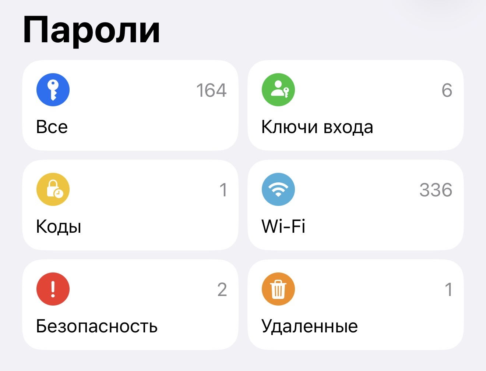
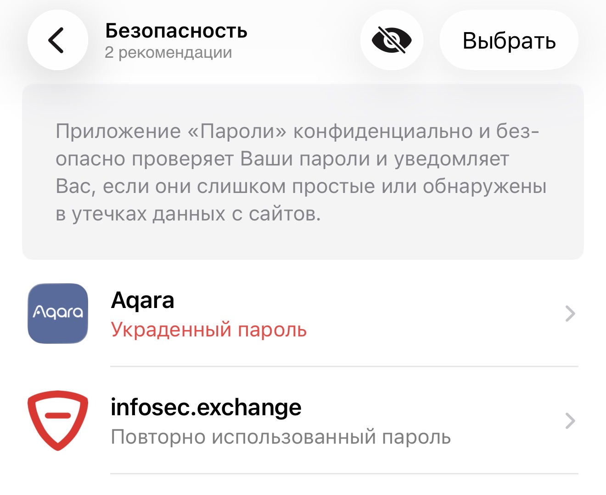

# Пароль

Главный принцип: **никогда не используйте одинаковые или похожие пароли.**

По двум причинам:
- Почту и пароль, утёкшие с одного сайта, часто потом проверяют на других — в вашей почте,
во ВКонтакте, на Ozon — и так взламывают аккаунты. Для этого никому не нужно охотиться лично
за вами: взломанные аккаунты — товар, и рынок у него большой.
- Если данные о ваших аккаунтах вместе с паролями всплыли в [утечках](./breaches.md), по общему
паролю свяжут между собой даже совершенно разные почты и номера телефонов
([хороший пример](https://web.archive.org/web/20220304080132/https://meduza.io/feature/2022/02/07/eto-pohozhe-na-krik-dushi-no-ya-ne-znayu-o-chem-on-krichit)).

Вторая причина важнее для приватности. Общий пароль связывает ваши аккаунты между собой так же
крепко, как общий номер телефона: он работает как ещё один ваш опознавательный знак. **Смена
пароля эту связь не стирает: запись «почта и пароль» остаётся в утечке навсегда.** Поэтому
пароль, который у вас уже где-то стоял, не ставьте больше нигде, даже на новом аккаунте.

## Менеджеры паролей

Запоминать сто паролей не придётся. Запомнить нужно один — от менеджера паролей.

Менеджер паролей — программа, которая придумывает пароли, хранит их и сама подставляет нужный
на нужном сайте. **Если телефон или браузер предлагает «сохранить пароль» и вы соглашаетесь,
менеджером вы уже пользуетесь:** в айфоне это приложение «Пароли», в Chrome и на Android —
Google Менеджер паролей, свой есть и в Яндекс Браузере.

С него и начните: [проверьте, какие ваши пароли уже утекли](#проверьте-свои-пароли-в-утечках).

Тот один пароль, который нужно помнить, у встроенного менеджера — пароль от аккаунта Apple,
Google или Яндекса, у отдельной программы — её главный пароль.

Аккаунт, в котором лежат пароли, теперь открывает всё остальное, поэтому защитите его отдельно:

- включите на нём двухфакторную аутентификацию: тогда для входа кроме пароля нужен код. Ищите её
в настройках безопасности аккаунта; лучше, чтобы код приходил не по СМС ([почему](./2fa.md));
- поставьте на телефон код длиннее четырёх цифр и не вводите его на виду: **кто знает код
и взял телефон, откроет все сохранённые пароли.** На айфоне включите «Защиту украденного
устройства» («Настройки» → «Face ID и код-пароль»): с ней вдали от дома и работы пароли
открываются только лицом или отпечатком, а код телефона не подойдёт;
- не ставьте на компьютер взломанные программы: вместе с ними можно скачать вирус, который
вытащит ваши пароли — и из браузера, и из текстовых файлов на рабочем столе.

Менеджер делает ещё одно, менее заметное: подставляет пароль только на том сайте, для которого
он сохранён. Открыли страницу входа, а менеджер пароль не предлагает — проверьте адрес: возможно,
это не тот сайт, который вы сохраняли. Глазами разницу между `vk.com` и `vk-com.ru` замечают
редко, а менеджер её видит.

Код для входа менеджер не защитит: его вы вводите сами. **Вводите коды только на сайте, куда
пришли сами, а не по ссылке из сообщения, и никому их не диктуйте.** Так угоняют аккаунты
в Telegram: вход там по коду, и без облачного пароля выманить достаточно его одного. Включите
его: «Настройки» → «Конфиденциальность» → «Облачный пароль».

Встроенный менеджер хранит пароли в вашем аккаунте Apple, Google или Яндекса. Пароли из айфона
на Android сами не появятся — их придётся переносить, а на компьютере с Windows для них нужна
программа iCloud от Apple. Отдельный менеджер не привязан ни к Apple, ни к Google: он одинаково
работает на любом телефоне и компьютере.

В браузере на компьютере пароли лучше не хранить: вирус достаёт их оттуда без труда.
Держите их в отдельном менеджере — там они зашифрованы главным паролем.

Из отдельных менеджеров советуем [Bitwarden](https://bitwarden.com/): его код открыт, так что
проверить, как он обращается с паролями, может любой специалист. Бесплатная версия хранит сколько
угодно паролей, работает на любом числе устройств, умеет хранить номера карт и заметки,
придумывает и обычные пароли, и пароли из случайных слов. Проверка сразу всех сохранённых паролей
по утечкам в нём платная.

Пароли хранятся на серверах Bitwarden в зашифрованном виде, и расшифровать их можно только вашим
главным паролем — поэтому он должен быть стойким. Все сохранённые пароли можно выгрузить в файл —
на случай, если сервис перестанет у вас открываться. Если при выгрузке не выбрать зашифрованный
формат, пароли в файле будут записаны открытым текстом: не оставляйте его в загрузках
и не пересылайте.

Главный пароль от Bitwarden запишите на бумаге и храните дома. **Если вы его забудете,
восстановить его не сможет никто, в том числе сам Bitwarden** — вместе с ним пропадут все
сохранённые пароли.

Не хотите держать пароли на чужих серверах — есть [KeePassXC](https://keepassxc.org/): он хранит
их в одном зашифрованном файле у вас на компьютере. Переносить этот файл на другие устройства
придётся самому, а на телефоне понадобится отдельное приложение.

## Проверьте свои пароли в утечках

Встроенный менеджер проверяет это сам. В айфоне откройте приложение «Пароли» и раздел «Безопасность»,
в Chrome и на Android — «Проверку паролей» в Google Менеджере паролей. Там видно, **какие
пароли уже нашлись в утечках и какие повторяются у вас на нескольких сайтах.**

Если пароль нашёлся, его уже пробуют при взломе. Менять его надо везде, где вы его
ставили, — список покажет тот же раздел. Первой меняйте почту: через неё сбрасываются пароли
от всего остального. Затем — Госуслуги и банки, потом магазины, где сохранена карта. Остальное
можно менять постепенно, когда заходите на сайт.

Менять так: на сайте или в приложении откройте настройки аккаунта и найдите смену пароля. В поле
для нового пароля телефон или браузер обычно сам предлагает случайный — согласитесь, и он
сохранится. После смены проверьте, что в менеджере записан новый пароль, а не старый.

Пароль, который нигде не сохранён, можно проверить в
[Pwned Passwords](https://haveibeenpwned.com/Passwords) — это база паролей из известных утечек.
Сам пароль туда не уходит: страница превращает его в необратимый код и отправляет только первые
пять знаков этого кода. С тех же пяти знаков начинаются коды около двух тысяч других паролей,
и какой из них ваш, сервис не узнаёт. Не хотите вводить пароль на чужой странице — просто смените его.

Про то, что ещё о вас есть в утечках, — глава [Утечки данных](./breaches.md).

## Как придумывать стойкие пароли

«Восемь символов, буквы, цифры и спецсимвол» — плохое требование: `P@ssw0rd` ему соответствует.

Подбирают пароль обычно не на самом сайте, а по базе, которая с него утекла. Пароли в ней чаще
всего записаны хешами — необратимыми кодами, — и программа перебирает варианты, пока код
не совпадёт. Как быстро это идёт, зависит от того, как сайт хранил пароли, и заранее вы этого
не знаете. Бывает, что пароли лежат в базе открытым текстом — тогда и подбирать нечего.

Короткий пароль перебирают целиком, символ за символом. Для длинного берут словарь — слова
и пароли из прошлых утечек — и применяют к каждому слову привычные правила: **приписать год,
сделать первую букву заглавной, заменить буквы на похожие цифры и значки.** Чем ближе ваш пароль
к такому шаблону, тем быстрее его найдут.

### Как надо: пароль из случайных слов

Самому придумывать нужно один пароль — тот, которым открывается менеджер: от аккаунта Apple,
Google или Яндекса либо главный пароль отдельной программы. Остальные менеджер придумает за вас:
когда вы регистрируетесь или меняете пароль, он предлагает случайный — соглашайтесь. А этот один
придётся помнить и набирать руками, поэтому его собирают из слов. Пока не запомнили, держите его
записанным на бумаге дома.

Совет «придумайте три случайных слова» не работает: человек случайное не придумывает. В голову
приходят слова из одной темы, из недавнего разговора, на одну букву, и такие сочетания
подбираются быстро.

Поэтому слова должны достаться вам готовыми. Их выдаёт
[генератор Bitwarden](https://bitwarden.com/password-generator/) — прямо на странице, без
регистрации; фраза составляется у вас в браузере и никуда не отправляется. Выберите в нём
Passphrase (парольная фраза), и получится что-то вроде
`decal-running-early-reflex-judicial-onshore`.
Слова в нём английские, русских он не предлагает. Что важно:

- слов берите шесть: каждое добавленное слово делает подбор в несколько тысяч раз дольше;
- оставляйте те слова, что выпали: заменив одно на своё любимое, вы делаете пароль
предсказуемым. Попалось незнакомое слово — нажмите ещё раз и возьмите новую фразу целиком;
- разделяйте слова дефисами или пробелами.

Такую фразу не подобрать, даже зная, из какого списка взяты слова: сочетаний слишком много,
чтобы перебрать их за человеческую жизнь.

### Как делать не надо

Два приёма советуют чаще всего, и оба не работают. Первый — заменить буквы на похожие цифры
и значки: «пароль» в виде `p@r0l`, «солнышко» в виде `s0lny5hk0`. Программы подбора делают это
сами: взяв слово из словаря, такая программа сразу пробует и все такие его написания. Список
замен лежит готовым файлом в комплекте hashcat — самой известной программы для подбора паролей —
и подключается одним параметром при запуске.

Второй приём — набрать русское слово в английской раскладке: `ехалгрекачерезреку` превращается
в `t[fkuhtrfxthtphtre`. Словари для подбора перегоняют в другую раскладку автоматически, а приём
настолько популярен, что такие пароли уже лежат в словарях готовыми строками. «Лаборатория
Касперского» [разобрала](https://www.kaspersky.ru/blog/passwords-hacking-research-2026/41817/)
231 миллион паролей из утечек, в том числе российских, и
[назвала](https://www.anti-malware.ru/news/2026-05-07-111332/49963) этот приём популярным.
**В паролях встречаются `gfhjkm` («пароль»), `vfvf` («мама»), `gfgf` («папа»), а в обратную сторону —
«мдфв» от `vlad`.** Там же выяснилось, что длина сама по себе не спасает: каждый пятый пароль
из 15 символов подбирают меньше чем за минуту, если он собран по привычному шаблону, а сайт
хранил пароли устаревшим способом — в исследовании это MD5.

## Вход без пароля

Passkey — это вход без пароля. По-русски его называют «ключ доступа», а в айфоне — «ключ входа».
Сайт обращается к вашему телефону или компьютеру, и тот подтверждает, что это вы, — отпечатком
пальца, лицом или ПИН-кодом. Пароля при этом нет вовсе. У сайта хранится только ключ, которым
он проверяет ваш телефон, и войти с этим ключом нельзя.

Что это даёт:

- **из утечки сайта ваш ключ не достать** — у сайта его нет. Старый пароль при этом никуда
не девается: пока он действует, войти можно и по нему, так что смените его на случайный;
- **поддельная страница не сработает**: ключ привязан к адресу сайта, и на поддельном сайте
браузер его не предложит. Такой сайт может попросить вместо ключа пароль или код из СМС —
не вводите их там, куда обычно входите по ключу.

Есть оговорка. Ключи хранятся в вашем аккаунте Apple или Google
либо в отдельном менеджере и переносятся между вашими устройствами в зашифрованном виде. Этот
аккаунт становится ключом ко всему остальному: кто завладел им, может получить все ваши входы разом.

«Входом без пароля» сервисы называют и другое: код из СМС или биометрию, образец которой
хранится у них на сервере. Тогда вход привязан к номеру телефона или к слепку лица, который лежит
не у вас. С passkey отпечаток и лицо телефон не покидают — как и при входе в приложение банка
по Face ID.

Поддержка меняется быстро, поэтому смотрите сами: в настройках безопасности сервиса ищите «ключ
доступа», «ключ входа» или passkey. Начать можно с аккаунта Google: он ключи доступа
поддерживает.

## LessPass

Что если вам сложно хранить пароли и синхронизировать их между разными устройствами? На помощь
приходят парольные менеджеры без необходимости что-то хранить. Они подойдут тем, кто не хочет
держать пароли ни в чьём облаке.

[LessPass](https://www.lesspass.com/) — не единственная подобная программа, но одна
из известнейших. Её концепция в том, что генерация паролей происходит на лету при помощи функции,
результат которой всегда одинаков при одинаковых параметрах.

Программе надо сообщить:
- главный пароль
- логин на сайте
- адрес сайта

После этого она без какой-либо отправки данных или сохранения чего-либо куда-либо сгенерирует
ваш пароль. В любой момент на любом устройстве вы можете запустить эту программу — и получить
свой пароль для конкретного сайта.

Минус у такого подхода тоже есть. Главный пароль не поменять отдельно: сменили его — сменились
все пароли сразу. А если какой-то сайт требует смены пароля или не принимает сгенерированный,
для него придётся помнить, какие настройки программы вы поменяли.

Есть и риск. Если пароль от одного сайта утечёт в открытом виде, по нему можно подбирать главный
пароль, а из главного получаются все остальные. Поэтому главный пароль здесь должен быть таким же
стойким, как у обычного менеджера.

## Полезные материалы и ссылки на источники

- [Свободный менеджер паролей LessPass работает на чистой функции](https://www.pvsm.ru/open-source/207324)

---

[⬅️ Назад](./location.md) | [⏫ Оглавление](../README.md) | [➡️ Вперёд](./photo.md)
